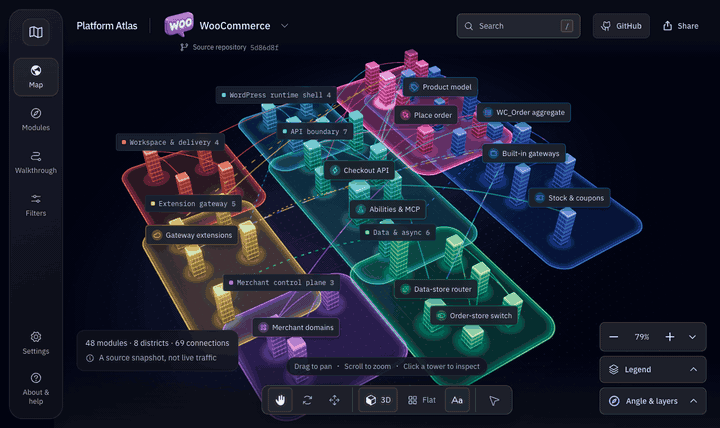
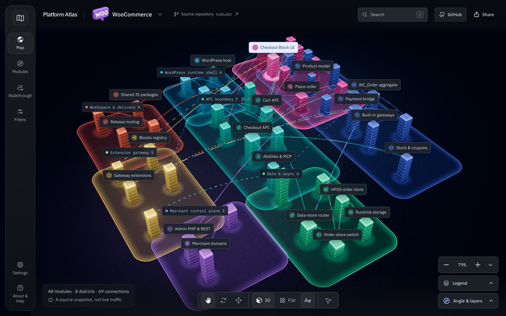
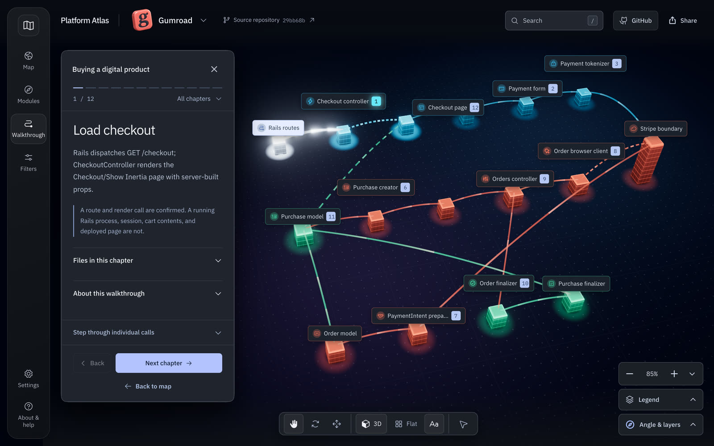
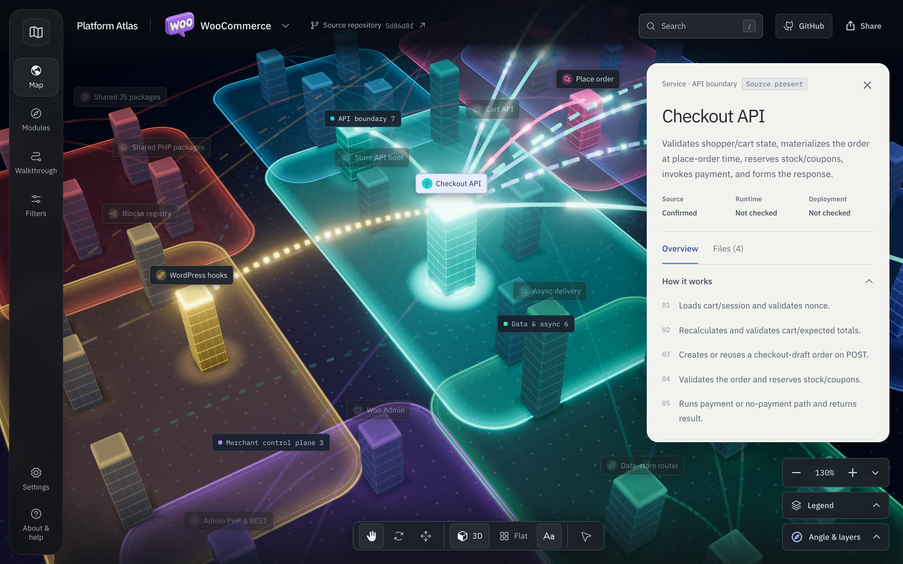
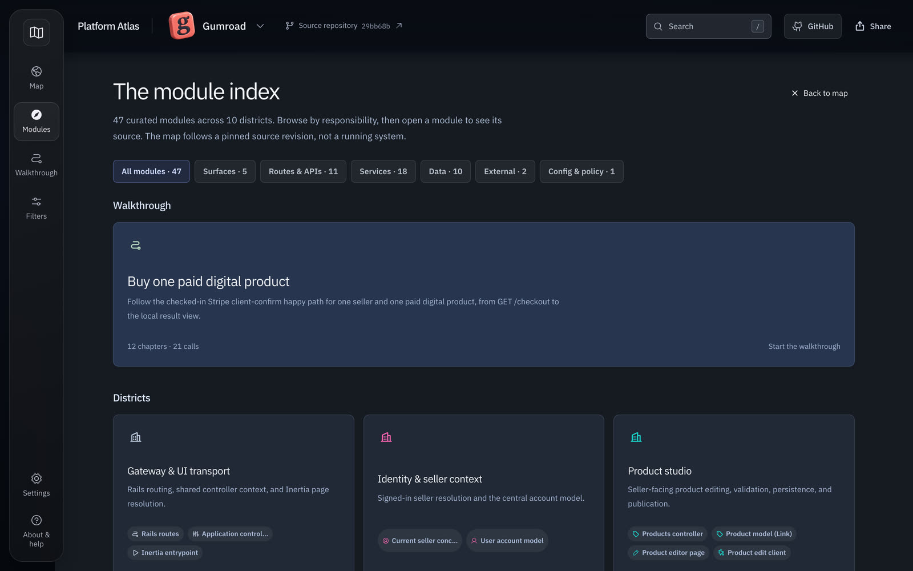

<div align="center">

# Platform Atlas

**Explore a codebase as a city.**<br>
Find a module, follow a real path through the code, and open the exact source file behind every claim.

[](https://github.com/doniv01/platform-atlas/actions/workflows/ci.yml)
[](https://doniv01.github.io/platform-atlas/)
[](LICENSE)


### [Open the live atlas →](https://doniv01.github.io/platform-atlas/)

[WooCommerce](https://doniv01.github.io/platform-atlas/) · [Gumroad](https://doniv01.github.io/platform-atlas/?atlas=gumroad) · [Checkout walkthrough](https://doniv01.github.io/platform-atlas/#journey) · [Overview](https://doniv01.github.io/platform-atlas/landing.html)



</div>

Platform Atlas draws a repository as a 3D city. Towers are modules, districts are parts of the system, and the lines between them are relationships you can find in the source. Select any tower to see what the module does and every file behind it, linked to GitHub at one pinned commit.

It ships with two curated atlases, **WooCommerce** and **Gumroad**, and runs anywhere static files can be served. There is no backend, no bundler, no API key, no CDN, and no analytics.

**Contents:** [Why](#why) · [Reading the city](#reading-the-city) · [What you can do](#what-you-can-do) · [Included atlases](#included-atlases) · [Run it locally](#run-it-locally) · [Deploy your own copy](#deploy-your-own-copy) · [Map your own repository](#map-your-own-repository) · [How it works](#how-it-works) · [Limits](#limits) · [Contributing](#contributing)

## Why

A file path helps once you know where to look. Before that, you need a picture of the parts and how they connect, and most architecture diagrams are stale or never say where their claims come from.

Platform Atlas keeps the picture and the evidence together. Each module lists the files it is based on. Each walkthrough chapter says where its evidence starts and stops. Source is marked as confirmed against the commit, and runtime and deployment are always marked **Not checked**, because code in a repository does not prove what runs in production.

## Reading the city

Every visual channel carries one meaning.

| Channel | Meaning |
| --- | --- |
| Color | The district the module belongs to |
| Height | The number of source files cited for the module |
| Base width | The number of connections |
| Solid line | A call, request, or read |
| Dashed line | A response returning control |
| Dotted line | A hook, event, or async job |
| Rose pulse | A write |
| Numbered badge | A chapter of the walkthrough |

Each module also carries a plain status: **Source present** (the code is on the described path), **Conditional** (a setting, flag, extension, or request decides whether it runs), **External** (a boundary with another system), or **Declared** (a manifest mentions it, and the code is not in the checkout). The **Legend** button in the app explains all of it.

## What you can do

| | |
| --- | --- |
| **Map** | Orbit, pan, and zoom around the city, or switch to a flat diagram. Search with <kbd>/</kbd> and filter by status. |
| **Walkthrough** | Follow one real flow chapter by chapter: placing an order with the WooCommerce Checkout Block, or buying a digital product on Gumroad. Step through the individual calls when you want the detail. |
| **Modules** | Browse every module by type or district when you would rather read a list. |
| **Source panel** | What the module does, how it works, its risks, and every file, each linked to the pinned commit. Copy a module's context as Markdown in one click. |

Choose between three finishes (Luminous, Matte, and Architectural), save a view, share a link to a module, or save a PNG of the scene. Press <kbd>?</kbd> in the app for keyboard shortcuts. It works on phones, with a bottom navigation bar and full-height reading panels.

| The city | Walkthrough |
| --- | --- |
|  |  |
| **Source panel** | **Module index** |
|  |  |

## Included atlases

| Atlas | Pinned revision | Coverage |
| --- | --- | --- |
| [WooCommerce](https://doniv01.github.io/platform-atlas/) | [`5d86d8f40b68`](https://github.com/woocommerce/woocommerce/tree/5d86d8f40b68039d16419049a40a3abf065ca71c) (Nov 5, 2026) | 48 modules in 8 districts, 69 connections, 6 source flows. Walkthrough: place an order with the Checkout Block (4 chapters, 22 calls). |
| [Gumroad](https://doniv01.github.io/platform-atlas/?atlas=gumroad) | [`29bb68b1c378`](https://github.com/antiwork/gumroad/tree/29bb68b1c37884b66a07062c7dcf9e19a71766d8) (Nov 6, 2026) | 47 modules in 10 districts, 40 connections. Walkthrough: buy one paid digital product (12 chapters, 21 calls). |

Both atlases are curated snapshots of one commit, and every cited line range was checked against that commit. They do not follow the upstream repository as it changes. A connection on the map means the relationship is in the source at that commit. It does not prove that a feature is enabled, that an external call succeeds, or that a deployment runs that code.

## Run it locally

You need Node.js 22 or newer. There is nothing to install.

```sh
git clone https://github.com/doniv01/platform-atlas.git
cd platform-atlas
npm start
```

Open [http://127.0.0.1:4183](http://127.0.0.1:4183). Switch atlases from the repository name in the header, or open [`?atlas=gumroad`](http://127.0.0.1:4183/?atlas=gumroad) directly. The overview page is at [`/landing.html`](http://127.0.0.1:4183/landing.html). The app has to be served over HTTP; opening `index.html` from the file system will not load its modules.

| Command | What it does |
| --- | --- |
| `npm start` | Serves the source folder at port 4183. Edit and refresh. |
| `npm run check` | Checks the syntax of every module and resolves every asset and import at `/` and at a project path. |
| `npm test` | Runs the offline test suite. |
| `npm run build` | Writes the deployable site to `dist/`. |
| `npm run preview` | Serves `dist/` at port 4184. Add `-- --base /platform-atlas/` to test a GitHub Pages project path. |

## Deploy your own copy

The repository deploys itself to GitHub Pages. **CI** checks, tests, and builds every push and pull request, and **Deploy to GitHub Pages** publishes `dist/` on every push to `main`.

1. Fork or clone the repository into your own account.
2. Turn on Pages with GitHub Actions as the source, once: **Settings → Pages → Source: GitHub Actions**.
3. Push to `main`, or run **Actions → Deploy to GitHub Pages**. The site appears at `https://<owner>.github.io/<repository>/`.

Every URL is relative, so the same build works at a domain root or under a project path. Both pages carry a Content-Security-Policy that only allows the site's own scripts, fonts, and images. See [docs/DEPLOYMENT.md](docs/DEPLOYMENT.md) for other hosts and troubleshooting.

## Map your own repository

The scanner reads committed Git objects and writes a deterministic JSON description of a repository's files, folders, and import relationships. It never checks out, installs, or runs the code it reads.

```sh
npm run scan -- --repo /path/to/a/local/repository --ref HEAD --output generated/my-repo.json
```

For WooCommerce and Gumroad, the tooling can also fetch the latest upstream commit and generate an exploratory pack to preview next to the curated one. Generated packs are always labelled as inferred. See [docs/SOURCE_WORKFLOW.md](docs/SOURCE_WORKFLOW.md) and [docs/DATA_CONTRACT.md](docs/DATA_CONTRACT.md) to turn a scan into a reviewed atlas of your own.

## How it works

The viewer is plain ES modules and CSS, with Three.js vendored in `vendor/` and mapped through an import map. Each atlas is a data module in `atlases/<id>/atlas-data.mjs`, listed in the registry inside `index.html`. The app loads one pack, renders the city with WebGL2 (with an SVG fallback), and keeps every interaction in the browser.

```text
index.html            App markup, import map, and atlas registry
landing.html          Overview page that links into the app
src/app.mjs           State, rendering, search, walkthroughs, and interactions
src/city-three.mjs    The Three.js city: towers, districts, connections, labels, camera
src/chrome.mjs        Scene finishes, source tabs, and walkthrough panel behavior
src/layout-flat.mjs   Non-overlapping layouts for the flat diagram
src/palette.mjs       District colors for each finish
src/icons.mjs         Local subset of Phosphor icons
src/styles/           foundation.css (base), app.css (theme), landing.css
atlases/              The curated WooCommerce and Gumroad packs
scripts/              Local server, build, checks, and the source-scanning tools
tests/                Offline tests for the packs, layout, renderer helpers, and tooling
docs/                 Guides, the data contract, and the scanner schema
```

Read more in [docs/ARCHITECTURE.md](docs/ARCHITECTURE.md) and [docs/USER_GUIDE.md](docs/USER_GUIDE.md).

## Limits

- This is a reading aid. It is no substitute for a complete dependency graph, a runtime trace, a security audit, or a deployment inventory.
- Curated claims are tied to their pinned commit and can go stale as the upstream code moves.
- File count is a weak proxy for size: a 6,000-line model can stand exactly as tall as a one-file service.
- The 3D view needs WebGL2. Without it, the app falls back to a simpler SVG rendering of the same data.
- Keyboard access, focus handling, reduced motion, and screen-reader labels are built in, but the app has not had a formal accessibility audit.

## Contributing

Corrections to the source evidence, clearer explanations, accessibility fixes, and new well-sourced atlases are welcome. Start with [CONTRIBUTING.md](CONTRIBUTING.md); there is an issue template for atlas corrections. Report security issues as described in [SECURITY.md](SECURITY.md).

## License

[MIT](LICENSE). Three.js and Phosphor Icons are MIT-licensed; IBM Plex is licensed under the SIL Open Font License. See [THIRD_PARTY_NOTICES.md](THIRD_PARTY_NOTICES.md).

WooCommerce and Gumroad are the projects being explored. Their names and marks belong to their owners, and this project is not affiliated with or endorsed by them.
